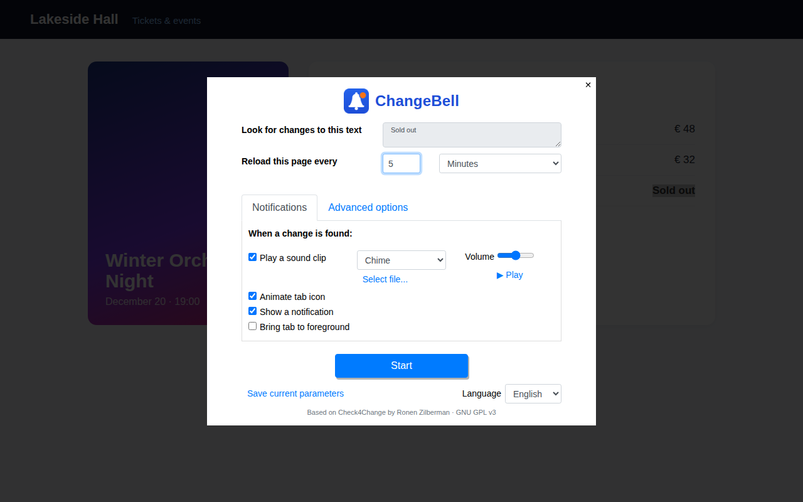
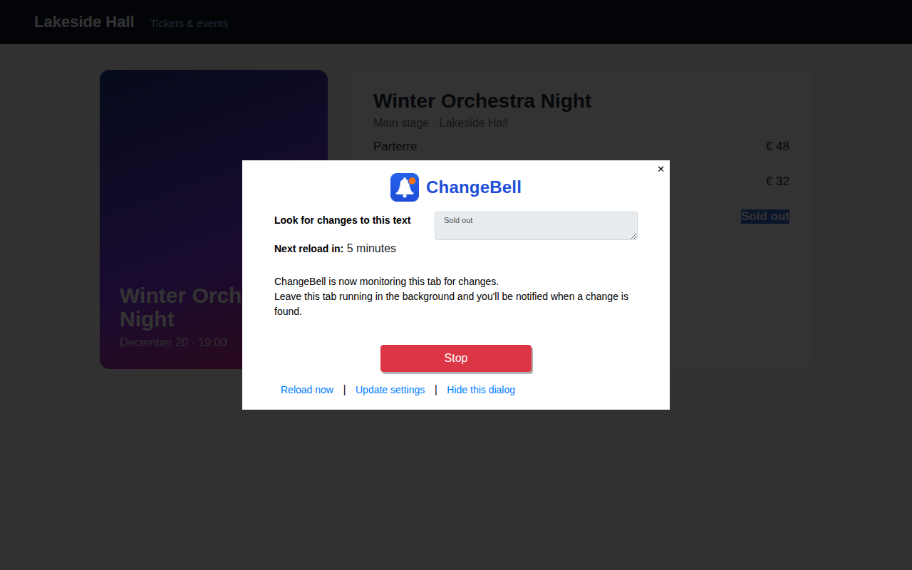

# ChangeBell

[](LICENSE.txt)


**ChangeBell** is a Microsoft Edge extension that watches a piece of a web page and rings when it changes.

Select the text you care about — a price, an order status, "Sold out", a queue number — click the bell and choose how often to check. ChangeBell reloads the page on schedule, compares the selected fragment with its previous version and alerts you with a sound, a system notification and a swinging bell on the tab icon.

[На русском ↓](#на-русском)



## Features

**How you are alerted.**
- A sound: six built-in tones or your own audio file (up to 5 MB), with volume and loop options.
- A system notification with the new text.
- An animated tab icon.
- Optionally, the tab is brought to the front.

**Watching options.**
- Quick intervals from the right-click menu (30 seconds, 5, 15 or 60 minutes, 4 hours) or any custom interval.
- Keep watching after the first change.
- Watch pages that update themselves, without reloading.
- Compare the HTML of the selection, not only its text.
- Random variation of the interval.
- A pause after the page loads before checking.

**Where it works.**
- Inside frames.
- On pages produced by a form: the form is re-submitted on reload.
- In several tabs at once, each with its own settings.

**Interface.** English and Russian, switchable in the settings.



## Install

- **Microsoft Edge Add-ons:** *link will appear after publication.*
- **From source:**
  1. Clone the repository.
  2. Open `edge://extensions`.
  3. Turn on **Developer mode**.
  4. Click **Load unpacked** and select the repository folder.

## Usage

1. Select the text you want to watch.
2. Click the ChangeBell button on the toolbar and set the interval, or right-click the selection and pick a preset.
3. Keep the tab open. When the text changes, you get the alert. Click anywhere on the page to stop the sound.

While a tab is monitored, the toolbar button opens a status dialog with **Stop**, **Reload now** and **Update settings**. Monitoring lasts while the browser is open.

## How it works

ChangeBell is a Manifest V3 extension:

| Part | Role |
|---|---|
| `service-worker.js`, `background/` | Jobs, scheduling, context menu, notifications. Waits use `chrome.alarms`. Short waits also get a timer, with the alarm as a fallback. Job state lives in `chrome.storage.session`, so it survives the service worker being stopped. |
| `contentscript/` | Injected on demand into the monitored tab. Saves and restores the selection as a DOM path, runs the title countdown and the tab-icon animation, re-submits POST forms. |
| `pages/` | In-page dialogs (how-to, settings, status), shown in an iframe lightbox. |
| `offscreen/` | Plays the alert sound; a service worker has no DOM. |
| `both/` | Shared helpers and the UI strings (`i18n.js`). |

A reload uses `tabs.reload()`, which keeps the original Referer and adds no history entries.

## Permissions

| Permission | Why |
|---|---|
| `tabs` | Reload the monitored tab, detect when it has loaded, bring it to the front. |
| `scripting` + `<all_urls>` | Inject the bundled content script into the tab where you start monitoring. You choose the site, so any site must be possible. |
| `alarms` | Keep the reload schedule while the service worker sleeps. |
| `storage` | Settings and custom sound (local), active jobs (session). |
| `notifications` | Alert with the new text. |
| `offscreen` | Play the alert sound. |
| `contextMenus` | Quick start, stop, highlight the monitored text. |
| `webNavigation` | Find the frame that holds the selection. |
| `webRequest` | Read-only, non-blocking: remember form fields of a POST page to re-submit it. |

## Privacy

Everything happens in the browser. ChangeBell has no servers, no analytics and no remote code, and sends nothing anywhere. See the [privacy policy](https://tepferviktor.github.io/ChangeBell/privacy-policy.html).

## Development

- Turn on verbose logs with `C4C_DEBUG = true` in `both/common.js`.
- The service worker console is at `edge://extensions` → ChangeBell → *service worker*.
- To rename the product, change `C4C_BRAND` in `both/i18n.js`, `_locales/*/messages.json`, and `short_name` / `default_title` in `manifest.json`.

Build a package for the store from the repository root:

```bash
zip -r ../changebell-1.0.0.zip . -x ".git/*" ".github/*" "docs/*"
```

## License and credits

ChangeBell is free software, released under the **GNU General Public License v3.0 or later**. See [LICENSE.txt](LICENSE.txt).

It is a modified version of **Check4Change 2.4**, Copyright 2006–2015 Ronen Zilberman, licensed under the GPL v3 or later. ChangeBell is not affiliated with or endorsed by the author of Check4Change. Files derived from the original carry a notice in their headers. The list of changes is in the section below.

**Changes from the original (2026):**
- Rebuilt for Manifest V3.
- The online service integration is removed: no installation IDs, statistics, premium tier or e-mail alerts.
- New name, icons, tab animation and alert sounds.
- Russian translation with a language switch; dialogs auto-fit their height.
- Reloading keeps the Referer; POST pages that can't be replayed fall back to GET.
- jQuery is updated to 3.7.1 and Bootstrap to 4.6.2.
- Several bug fixes.

Third-party components:
- [jQuery](https://jquery.com/) 3.7.1 — MIT.
- [Bootstrap](https://getbootstrap.com/) 4.6.2 with Popper.js 1.16.1 — MIT.
- [Featherlight](https://noelboss.github.io/featherlight/) 1.7.14 — MIT.

---

## На русском

**ChangeBell** — расширение для Microsoft Edge, которое следит за фрагментом веб-страницы и звонит, когда он меняется.

Выделите текст, который важен: цену, статус заказа, «Нет в наличии», номер в очереди. Нажмите колокольчик и выберите, как часто проверять. ChangeBell перезагружает страницу по расписанию, сравнивает выделенный фрагмент с прошлой версией и сообщает об изменении звуком, системным уведомлением и качающимся колокольчиком на значке вкладки.

### Возможности

- **Сигнал:** звук (шесть встроенных или свой файл до 5 МБ), уведомление с новым текстом, анимация значка вкладки и, по желанию, переключение на вкладку.
- **Интервалы:** быстрые в меню по правому клику (30 секунд, 5, 15 или 60 минут, 4 часа) или любой свой.
- **Дополнительные режимы:**
  - продолжать после первого изменения;
  - следить без перезагрузки за страницами, которые обновляются сами;
  - сравнивать HTML, а не только текст;
  - случайный разброс интервала;
  - пауза после загрузки страницы.
- **Где работает:** во фреймах, на страницах после отправки формы и в нескольких вкладках одновременно.
- **Язык интерфейса:** русский или английский, переключается в настройках.

### Установка

- **Из магазина Microsoft Edge Add-ons:** ссылка появится после публикации.
- **Из исходников:**
  1. Склонируйте репозиторий.
  2. Откройте `edge://extensions`.
  3. Включите «Режим разработчика».
  4. Нажмите «Загрузить распакованное расширение» и выберите папку репозитория.

### Конфиденциальность

Всё происходит в браузере. У ChangeBell нет серверов, аналитики и удалённого кода, расширение ничего никуда не отправляет.

### Лицензия

GNU GPL v3 или более поздняя версия. ChangeBell — изменённая версия Check4Change 2.4 (Copyright 2006–2015 Ronen Zilberman). Автор оригинала к ChangeBell отношения не имеет.
